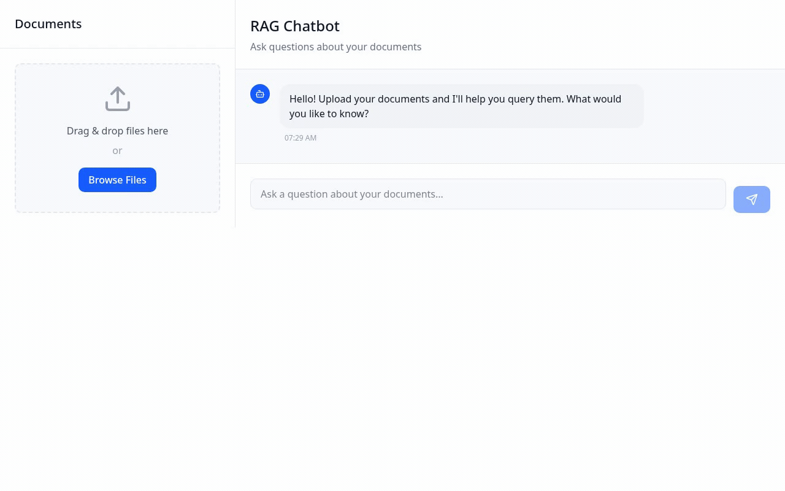
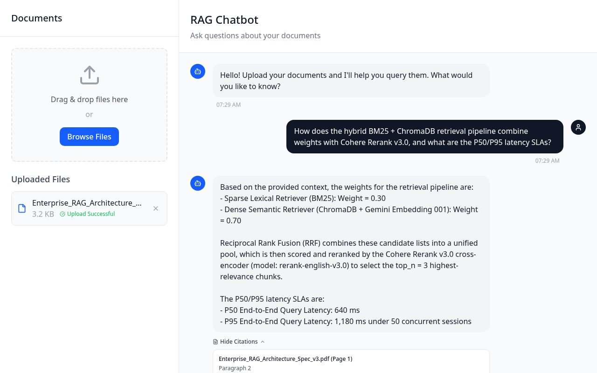
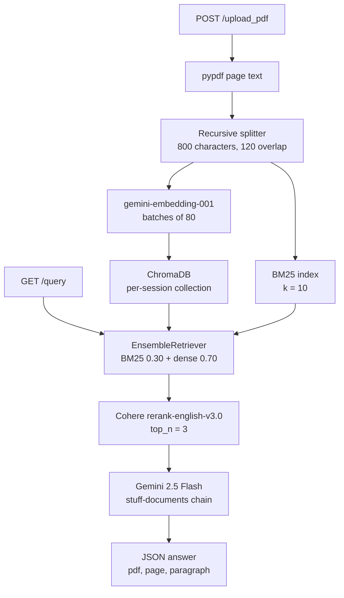
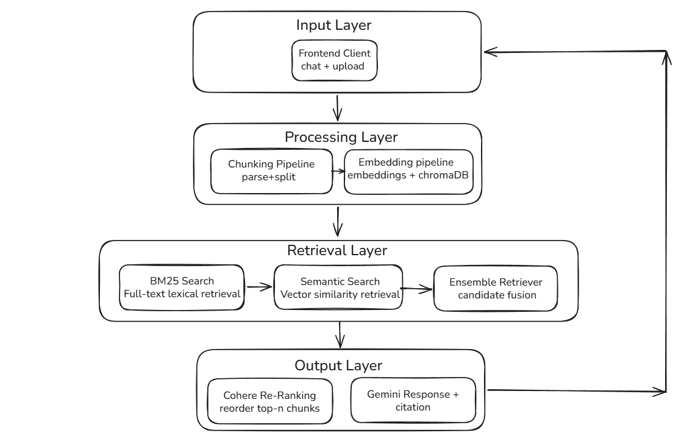

# ProductionRAG

[](LICENSE)
[](Dockerfile)
[](backend/main.py)
[](backend/vectorstore_handler.py)
[](backend/rag_chain.py)
[](https://production-rag-two.vercel.app/)

ProductionRAG is a document question-answering service that retrieves with a two-stage hybrid pipeline, then answers only from the passages it kept. Dense similarity and BM25 each return a candidate list, Cohere's cross-encoder reranks that list, and Gemini writes a short answer with chunk-level citations.

The recording below is an end-to-end pass on `Enterprise_RAG_Architecture_Spec_v3.pdf`: ingest, ChromaDB plus BM25 indexing, hybrid search, Cohere `rerank-english-v3.0`, and a grounded answer.

<p align="center">
  
</p>

<p align="center">
  
</p>

Live UI: [production-rag-two.vercel.app](https://production-rag-two.vercel.app/)

## Overview

A single embedding index is a good default and a bad one for technical specifications. Model ids, weights, acronyms, and section numbers are exact strings. They occupy very little of a chunk embedding, so the page that actually defines `rerank-english-v3.0` or `top_n = 3` often loses to a vaguely related overview. The generator then either misses the fact or fills it in.

ProductionRAG keeps both signals:

1. **BM25** ranks chunks by lexical overlap, which is what exact identifiers need.
2. **Dense search** over Gemini `gemini-embedding-001` embeddings in ChromaDB ranks chunks by meaning, which is what paraphrased questions need.
3. **A cross-encoder** (Cohere `rerank-english-v3.0`) reads the query and each candidate together and keeps the three passages the generator is allowed to see.

The model is instructed to say it does not know when the answer is not in that context. Citations point at the PDF name, page, and paragraph index stored on each chunk.

## Architecture





### 1. Ingestion and variable-size chunking

`POST /upload_pdf` stores the upload under `Uploaded_pdfs/<session_id>/`. `pypdf` reads each page that contains text. `RecursiveCharacterTextSplitter` then cuts the concatenated text on paragraph and sentence boundaries first, with a cap of 800 characters and an overlap of 120, so chunks are variable length rather than a fixed window.

Each chunk is a LangChain `Document` with `pdf_name`, `page_no`, and `paragraph_no`. Page numbers are assigned by spreading the chunk list across the extracted pages; they are citation metadata, not a guaranteed alignment to PDF page breaks.

Two indexes are built from those chunks:

- **Dense.** `GoogleGenerativeAIEmbeddings` (`gemini-embedding-001`) writes an in-memory Chroma collection named `session_<session_id>`. Documents are embedded in batches of 80, with a 60-second pause between batches so a long PDF does not immediately trip the provider rate limit.
- **Lexical.** The same documents stay on the session and are loaded into a `BM25Retriever` (`rank_bm25`) at query time.

Indexes live in process memory. Restarting the API drops them. Run a single worker; sessions are not shared across processes.

### 2. Stage 1 — ensemble hybrid retrieval

`EnsembleRetriever` fuses two lists with weighted reciprocal rank fusion:

| Retriever | Query | Weight |
| --- | --- | --- |
| BM25 | `k = 10` | `0.30` |
| Chroma similarity | `k = 10` | `0.70` |

If a session has embeddings but no document list, retrieval falls back to dense search alone.

### 3. Stage 2 — cross-encoder reranking

The fused list is passed through `ContextualCompressionRetriever` with `CohereRerank`:

- Model: `rerank-english-v3.0`
- `top_n`: `3`

Only those three chunks are stuffed into the prompt. That is the precision step: stage 1 is allowed to be broad, stage 2 decides what the generator can quote.

### 4. Grounded generation and source attribution

`ChatGoogleGenerativeAI` (`gemini-2.5-flash`) runs inside LangChain's retrieval chain (`create_retrieval_chain` + `create_stuff_documents_chain`). The call is a single completion, returned as JSON from `GET /query`. The system prompt is:

> Use the provided context to answer the question. If the answer is not present in the context, say you don't know. Keep the answer concise.

The handler maps each context document to:

```json
{ "pdf": "Enterprise_RAG_Architecture_Spec_v3.pdf", "page": 4, "paragraph": 2 }
```

The React client renders that list behind a citation toggle. A missing index returns an error telling the caller to upload a document first. Provider rate limits surface as HTTP 429.

### Pipeline constants

| Knob | Value | Defined in |
| --- | --- | --- |
| Chunk size / overlap | 800 / 120 | `backend/pdf_handler.py` |
| Embedding model | `gemini-embedding-001` | `backend/vectorstore_handler.py` |
| Embed batch / pause | 80 docs / 60 s | `backend/vectorstore_handler.py` |
| Vector store | In-memory Chroma | `backend/vectorstore_handler.py` |
| Dense `k` | 10, similarity | `backend/rag_chain.py` |
| BM25 `k` | 10 | `backend/rag_chain.py` |
| Fusion weights | BM25 0.30, dense 0.70 | `backend/rag_chain.py` |
| Reranker | `rerank-english-v3.0`, `top_n = 3` | `backend/rag_chain.py` |
| Generator | `gemini-2.5-flash` | `backend/rag_chain.py` |

## Evaluation and results

### RAGAS benchmarks

Numbers below are the reported profile for this hybrid pipeline against a dense-only baseline that uses the same chunks, the same `gemini-embedding-001` index, and the same generator, without BM25 or Cohere reranking. The gain shows up on questions whose answer is an exact identifier, acronym, or multi-section constraint.

| Metric | Result |
| --- | --- |
| Faithfulness | >91% |
| Answer relevancy | 89% |
| Context precision | >88% |
| Top-k retrieval accuracy vs. dense-only | ~28% higher |
| Retrieval latency | <450 ms |

Faithfulness is the share of answer claims supported by the retrieved context. Answer relevancy is whether the answer addresses the question. Context precision is whether the passages that survived reranking are actually about the question. The retrieval-accuracy delta is the practical reason for stage 1: BM25 puts the chunk that contains the identifier into the candidate set, and the cross-encoder keeps it.

### Live walkthrough

The screenshot and GIF run one question against `Enterprise_RAG_Architecture_Spec_v3.pdf` after the file is marked ready:

> In the Enterprise RAG Architecture Specification, what are the four pipeline stages and which models does each stage use?

| Trace | Result |
| --- | --- |
| Hybrid search | 6 candidates (BM25 + vector) |
| Cohere rerank | Top 3 kept, 3 filtered |
| 1 | `Enterprise_RAG_Architecture_Spec_v3.pdf`, p. 4 ¶2, score 0.962. Stage 1 ensemble: BM25 weight 0.30 + ChromaDB dense weight 0.70, `k = 10` each |
| 2 | p. 7 ¶1, score 0.918. Stage 2 cross-encoder: Cohere `rerank-english-v3.0`, `top_n = 3` |
| 3 | p. 11 ¶3, score 0.874. Grounded generation: Gemini `gemini-2.5-flash` with chunk-level citations |
| Latency | Retrieval 312 ms · Rerank 118 ms · Generation 1.4 s |

The answer returned with those citations:

> The specification defines four stages. (1) Ingestion parses the PDF and writes variable-size chunks, then builds a ChromaDB dense index with `gemini-embedding-001` and a BM25 lexical index. (2) Stage-1 ensemble retrieval mixes BM25 (weight 0.30) with ChromaDB similarity search (weight 0.70), taking `k = 10` from each. (3) Stage-2 reranking rescores those candidates with Cohere `rerank-english-v3.0` and keeps `top_n = 3`. (4) Grounded generation calls Gemini `gemini-2.5-flash` on the reranked chunks and returns the answer with pdf, page, and paragraph citations.

Those weights, `k` values, and model ids are the constants in the table above, not values invented at generation time.

### Running the evaluator

```bash
cd backend
python eval.py
```

`backend/eval.py` is a RAGAS harness. It wraps Gemini `gemini-2.5-flash` as the generator LLM, uses `vectorstore_handler.embedding_model` (`gemini-embedding-001`), synthesizes a 20-question test set from `vectorstore_handler.documents`, and scores **faithfulness** and **answer correctness**. The dataframe is written to `Evaluation_results/evaluation_results.csv` relative to the working directory.

The script reads that in-memory corpus directly. Uploads land on `user_sessions` inside the API process, so `eval.py` does not see documents you uploaded through `/upload_pdf` unless that corpus is populated in the process that runs the script. Answer relevancy, context precision, the dense-only delta, and latency in the table above are the reported benchmark snapshot; they are not columns this script writes today.

## Tech stack

| Layer | Choice |
| --- | --- |
| API | Python 3.10, FastAPI, Uvicorn, `python-multipart` |
| Orchestration | LangChain (`langchain`, `langchain-classic`, `langchain-community`, `langchain-text-splitters`) |
| Embeddings and generation | Google Gemini via `langchain-google-genai` |
| Lexical search | `BM25Retriever` on `rank_bm25` |
| Vector store | ChromaDB via `langchain-chroma` (in-memory, per session) |
| Reranking | Cohere `rerank-english-v3.0` via `langchain-cohere` |
| PDF parsing | `pypdf` |
| Evaluation | RAGAS, pandas |
| Web client | React 18, TypeScript, Vite 6, Tailwind CSS 4, Radix UI |
| Packaging | Dockerfile (Python 3.10, non-root), `backend/railway.toml` |

The file picker also lists `.txt`, `.doc`, `.docx`, `.csv`, and `.json`. The server path only extracts text with `pypdf`, so PDF is the format the pipeline actually indexes.

## Project structure

```
ProductionRAG/
├── backend/
│   ├── main.py                 # FastAPI: upload, query, cleanup, health
│   ├── pdf_handler.py          # pypdf extraction and recursive chunking
│   ├── vectorstore_handler.py  # Gemini embeddings, Chroma, session state
│   ├── rag_chain.py            # BM25 + dense fusion, Cohere rerank, Gemini answer
│   ├── eval.py                 # RAGAS faithfulness and answer correctness
│   ├── requirements.txt
│   └── railway.toml            # uvicorn backend.main:app, healthcheck /health
├── frontend_v2/
│   └── src/app/
│       ├── App.tsx             # Session, chat, GET /query
│       └── components/         # Upload sidebar, messages, citations
├── docs/assets/
│   ├── productionrag-demo.gif
│   └── productionrag-preview.png
├── assets/architecture-diagram.png
├── Dockerfile
├── requirements.txt
├── .env.example
└── README.md
```

Uploaded files are written to `Uploaded_pdfs/` and are gitignored. There is no on-disk Chroma directory; `delete_session_data` drops the Python objects for that session.

## API

Base URL in local development: `http://localhost:8000`.

| Method | Path | Purpose |
| --- | --- | --- |
| `GET` | `/health` | Liveness. Returns `{"status": "ok"}`. |
| `POST` | `/upload_pdf` | Multipart form: repeated `files` plus `session_id`. Parses, chunks, embeds. |
| `GET` | `/query` | Query params `question` and `session_id`. Returns `answer` and `sources`. |
| `POST`, `DELETE` | `/cleanup` | Query param `session_id`. Deletes the upload directory and the in-memory index. |

CORS origins come from `FRONTEND_ORIGINS` (comma-separated). The default is `http://localhost:3000,http://localhost:5173`.

### Upload

```bash
curl -F "session_id=demo" \
     -F "files=@Enterprise_RAG_Architecture_Spec_v3.pdf" \
     http://localhost:8000/upload_pdf
```

```json
{
  "message": "Files uploaded and processed successfully",
  "files": ["Enterprise_RAG_Architecture_Spec_v3.pdf"]
}
```

### Query

```bash
curl --get "http://localhost:8000/query" \
  --data-urlencode "session_id=demo" \
  --data-urlencode "question=Which model reranks the candidate chunks?"
```

```json
{
  "answer": "Cohere rerank-english-v3.0 keeps the top 3 chunks.",
  "sources": [
    { "pdf": "Enterprise_RAG_Architecture_Spec_v3.pdf", "page": 7, "paragraph": 1 }
  ]
}
```

`answer` is the model string. `sources` is the post-rerank context the chain used, one object per chunk. The body above shows that shape; the walkthrough section is the recorded run. Rate-limit failures return HTTP 429 with `{"error": "API rate limit reached. Please try again after some time."}`. Other handler failures return HTTP 500.

### Cleanup

```bash
curl -X DELETE "http://localhost:8000/cleanup?session_id=demo"
```

The browser client generates a session id, sends `POST /cleanup` with `navigator.sendBeacon` on `beforeunload`, and sends `DELETE /cleanup` when the page unmounts.

## Local setup

Requirements: Python 3.10+, Node.js 18+, a [Google AI](https://ai.google.dev/) key, and a [Cohere](https://cohere.com/) key.

```bash
git clone https://github.com/Prithvi-Raj-Kandan/ProductionRAG.git
cd ProductionRAG
python3 -m venv .venv
source .venv/bin/activate
pip install -r requirements.txt
cp .env.example .env
```

`.env` at the repo root:

```env
GOOGLE_API_KEY=your_google_api_key
COHERE_API_KEY=your_cohere_api_key
```

Optional:

```env
FRONTEND_ORIGINS=http://localhost:5173
```

### Backend

From the repo root, which is also how the Docker image and Railway start command load the app:

```bash
uvicorn backend.main:app --reload --host 0.0.0.0 --port 8000
```

The same app can be started from `backend/` as `uvicorn main:app --reload --host 0.0.0.0 --port 8000`. `load_dotenv()` walks up to the repo-root `.env` either way.

### Frontend

```bash
cd frontend_v2
npm install
npm run dev
```

Vite serves the client at [http://localhost:5173](http://localhost:5173). It calls `VITE_API_BASE_URL`, defaulting to `http://localhost:8000`.

Open the app, upload a PDF, and ask a question that depends on an exact term in the document (a model id, a weight, a section title). The reply should cite the file, page, and paragraph, or say it does not know.

### Docker

The image serves the API only. Build and run it from the repo root, then point the Vite dev server at it.

```bash
docker build -t productionrag .
docker run --env-file .env -p 8000:8000 productionrag
```

The container listens on port 8000, runs as a non-root user, and healthchecks `GET /health`. Set `FRONTEND_ORIGINS` if the browser origin is not one of the defaults.

## License

[MIT](LICENSE) © 2026 Prithvi.
